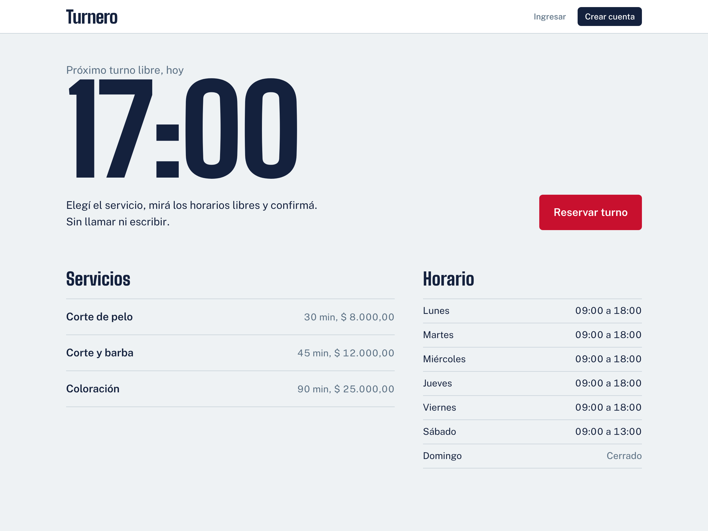
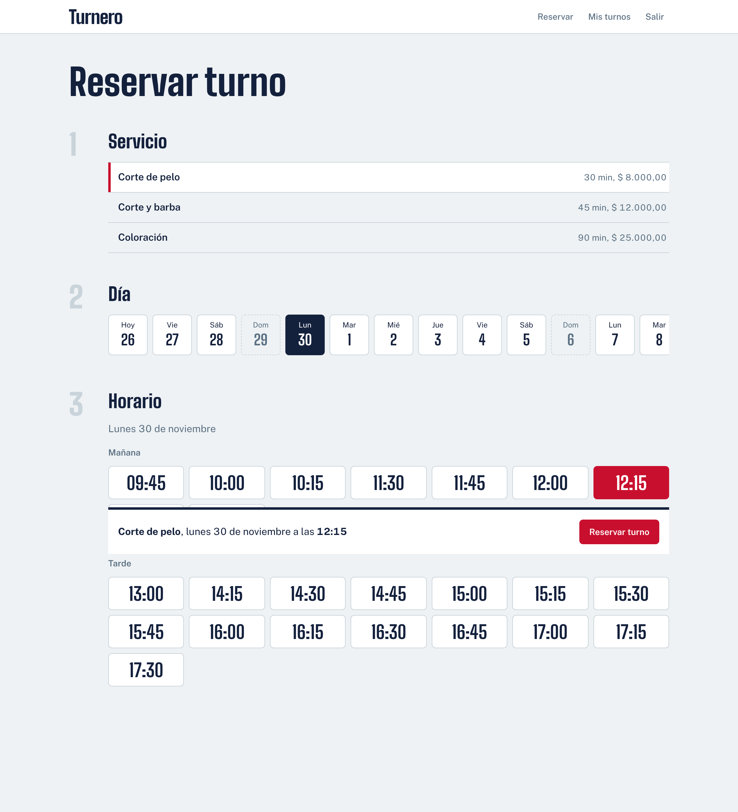
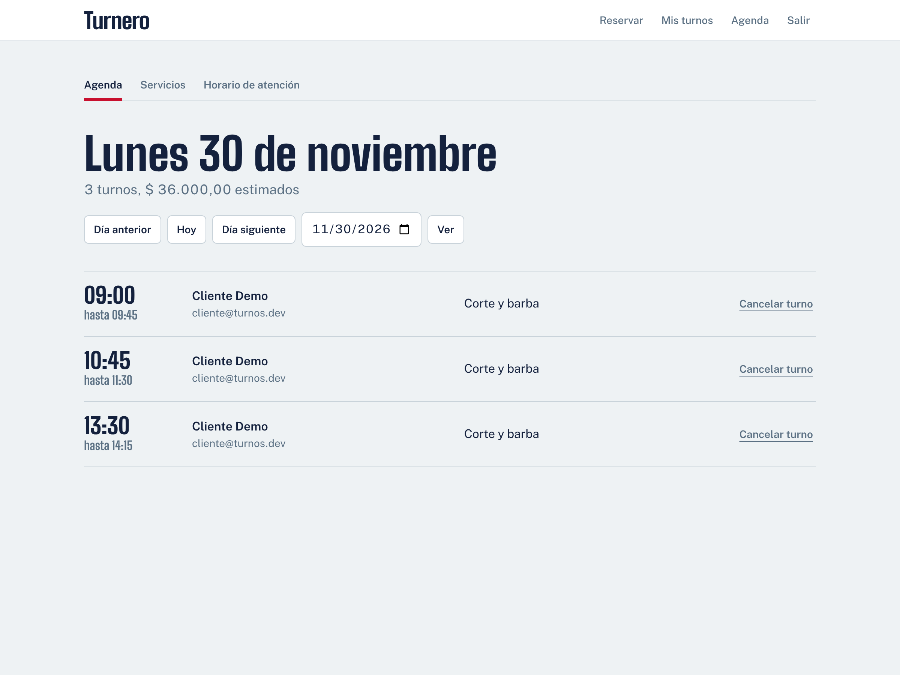

# Turnero · Reserva de turnos online

App web full stack para que un pequeño negocio (peluquería, consultorio, estudio) reciba reservas online.
Los clientes ven los horarios libres en tiempo real y reservan en segundos; el negocio administra servicios,
horarios de atención y su agenda diaria.

**Stack:** Next.js 15 (App Router, Server Actions) · TypeScript · PostgreSQL (Neon) · Prisma + node-postgres · Tailwind CSS · Zod · Vitest · GitHub Actions · Vercel



| Reserva | Agenda del admin |
|---|---|
|  |  |

**Demo:** https://turnero-app-lake.vercel.app (cliente `cliente@turnos.dev` / `cliente1234`, admin `admin@turnos.dev` / `admin1234`)

## Funcionalidades

**Clientes**
- Registro e inicio de sesión.
- Reserva en 3 pasos: servicio → día → horario libre.
- Ver y cancelar sus próximos turnos.

**Administración**
- Agenda diaria con turnos, estado e ingresos estimados.
- Alta, activación y desactivación de servicios (duración y precio).
- Horario de atención semanal editable.
- Cancelación de cualquier turno.

**Detalles técnicos destacados**
- **Imposible reservar dos veces el mismo horario**, incluso con requests simultáneos: una *exclusion constraint* de PostgreSQL rechaza rangos de tiempo superpuestos ([migración](prisma/migrations)).
- Cálculo de disponibilidad como **función pura** testeada de forma aislada ([`src/lib/slots.ts`](src/lib/slots.ts)).
- Autenticación con contraseñas hasheadas (bcrypt) y sesión en **cookie httpOnly firmada** (JWT HS256), con control de acceso por rol en middleware y en cada Server Action.
- Fechas guardadas en UTC y mostradas en la zona horaria del negocio.
- Tests de integración contra PostgreSQL real, ejecutados en CI.

## Correrlo en local

Requisitos: Node 20+ y PostgreSQL 14+ (local o en Docker).

```bash
# 1. Base de datos (si usás Docker)
docker run -d --name turnos-db -e POSTGRES_PASSWORD=postgres -p 5432:5432 postgres:16
docker exec turnos-db psql -U postgres -c "CREATE DATABASE turnos" -c "CREATE DATABASE turnos_test"

# 2. Dependencias y variables de entorno
npm install
cp .env.example .env        # completá AUTH_SECRET con: openssl rand -base64 32

# 3. Migraciones y datos de ejemplo
npx prisma migrate dev
npm run db:seed

# 4. Levantar
npm run dev                 # http://localhost:3000
```

Usuarios de ejemplo creados por el seed:

| Rol     | Email                | Contraseña    |
|---------|----------------------|---------------|
| Admin   | admin@turnos.dev     | admin1234     |
| Cliente | cliente@turnos.dev   | cliente1234   |

## Tests

```bash
DATABASE_URL=$TEST_DATABASE_URL npx prisma migrate deploy   # una sola vez
npm test
```

- `tests/slots.test.ts`: unit tests del cálculo de horarios (bordes, cierre, pasado, superposición).
- `tests/booking.integration.test.ts`: reservas contra PostgreSQL real, incluida una **carrera de dos reservas simultáneas** donde solo una debe ganar. Se saltean si no hay `TEST_DATABASE_URL`.

## Despliegue

Ver [docs/DEPLOY.md](docs/DEPLOY.md): Vercel + Neon, ambos con plan gratuito. La base vive en Neon, con conexión pooled para la app y directa para las migraciones.

## Estructura

```
prisma/
  schema.prisma          modelos: User, Service, BusinessHours, Appointment
  migrations/            SQL versionado (incluye la exclusion constraint)
  seed.ts                datos de ejemplo
src/
  middleware.ts          protege /reservar, /mis-turnos y /admin
  app/
    actions/             Server Actions (auth, turnos, admin)
    reservar/ mis-turnos/ admin/ login/ registro/
  lib/
    slots.ts             cálculo de disponibilidad (puro)
    booking.ts           reglas de negocio de reservas
    session.ts auth.ts   firma/verificación de sesión y helpers de rol
    validation.ts        esquemas Zod
tests/
```

## Próximos pasos (v2)

- Varios profesionales por negocio y multi negocio (multi-tenant).
- Recordatorios por email.
- Reprogramar turnos y políticas de cancelación con anticipación mínima.
- Rate limiting en login y tests end-to-end con Playwright.

Las decisiones técnicas y sus alternativas están en [docs/DECISIONES.md](docs/DECISIONES.md), y las de diseño visual en [docs/DISENO.md](docs/DISENO.md).
